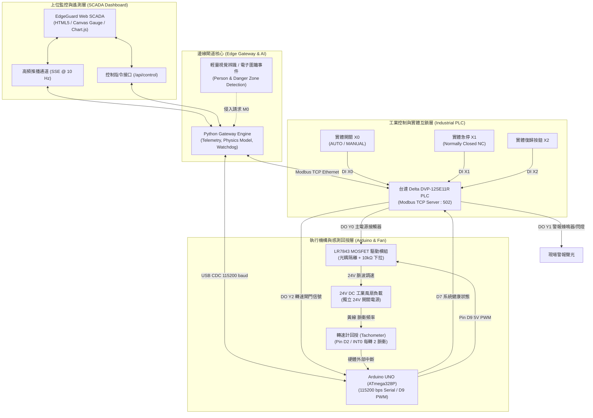

# EdgeGuard IoT — 工業自動化防護儀表板與 PLC / Arduino 控制核心

> **EdgeGuard: Offline AI Safety Copilot for Legacy Industrial Equipment**  
> 專為既有傳統工業設備設計之邊緣安全互鎖、高頻即時監控儀表板與實體控制整合專案。  
> 適用於 **ASUS UGen AI League 創新黑客松**（Battlefield Lightning 輕量運算組 / Stage I & Stage II）。

---

## 1. 系統架構與設計理念 (System Architecture)

EdgeGuard 的核心理念是：**「讓既有設備取得現場感知能力，透過原有 PLC 執行受限制、可追溯且具備物理互鎖的反應。」**

在工業安全規範中，純軟體或遠端 AI 模型絕不能具備任意覆蓋機台硬體的無限制權限。本專案透過 **台達 DVP-12SE11R PLC** 作為最終實體安全互鎖閘門，結合 **Arduino UNO 微控制器** 驅動 24V 風扇負載與轉速（Tachometer）回授，並透過 **EdgeGuard SCADA 工業物聯網儀表板** 提供 10 Hz 高頻即時遙測、事件軌跡稽核與雙向控制。



---

## 2. 目錄結構 (Repository Layout)

```text
edgeguard-iot/
├── README.md                      # 專案完整架構、接線指南與測試說明
├── run_dashboard.py               # 儀表板一鍵啟動腳本 (支援仿真與實體硬體)
├── .gitignore                     # Git 忽略配置檔
│
├── plc/                           # 台達電子 DVP-12SE11R PLC 程式與配置
│   ├── README.md                  # PLC 載入說明與安全邏輯架構
│   ├── edgeguard_dvp12se_ladder.il# 標準指令表 (Mnemonic / Instruction List)
│   ├── edgeguard_dvp12se_ladder.txt# ASCII 視覺化階梯圖結構與註解
│   ├── modbus_mapping.md          # 完整 Modbus TCP 點位對照表 (D/M/X/Y)
│   ├── modbus_mapping.json        # 機器可讀 JSON 格式點位定義
│   └── test_plc_modbus.py         # PLC 通訊測試與點位診斷 CLI 工具
│
├── arduino/                       # Arduino UNO 風扇致動與轉速監測韌體
│   ├── src/
│   │   └── edgeguard_fan_controller.ino # Arduino C++ 核心韌體
│   ├── wiring_guide.md            # 電氣接線圖、MOSFET 隔離與安全規範
│   └── test_serial.py             # 序列通訊測試與 RPM 即時監看工具
│
└── dashboard/                     # 工業 SCADA Web 監控儀表板
    ├── server.py                  # Python HTTP & SSE 伺服器 (內建電機物理引擎)
    ├── requirements.txt           # 硬體連線選用套件 (pymodbus, pyserial)
    └── static/
        └── index.html             # SCADA 單頁式儀表板 (Tailwind + Canvas + Chart.js)
```

---

## 3. 台達 PLC 控制邏輯與 Modbus 對照表 (Delta PLC System)

### 3.1 實體 I/O 點位分配 (DVP-12SE11R)

| 點位 | 類型 | 標記名稱 | 功能說明 | 正常狀態 |
|---|---|---|---|---|
| **X0** | DI | `SW_MODE` | 運轉模式切換（1 = AUTO 模式，0 = MANUAL 模式） | 選擇開關 |
| **X1** | DI | `E_STOP_PB` | 實體緊急停止按鈕（常閉 NC 接線：1 = 迴路正常，0 = 按下急停） | 常閉 NC (1) |
| **X2** | DI | `RESET_PB` | 實體安全故障復歸按鈕（常開 NO 接線） | 常開 NO (0) |
| **X3** | DI | `START_PB` | 工作站現地啟動按鈕 | 常開 NO (0) |
| **X4** | DI | `STOP_PB` | 工作站現地停止按鈕 | 常閉 NC (1) |
| **X5** | DI | `ARDUINO_OK`| Arduino 控制器健康與看門狗回授信號 | 5V 經光耦 (1) |
| **Y0** | DO | `FAN_POWER` | 24V 風扇主電源接觸器繼電器 | 運轉導通 |
| **Y1** | DO | `ALARM_LAMP`| 現場警報蜂鳴器與三色警示燈 | 故障觸發 |
| **Y2** | DO | `SPEED_GATE`| 輸出至 Arduino 之轉速致能硬體信號 | 允許運轉 (1) |
| **Y3** | DO | `HEARTBEAT` | PLC 運轉指示閃爍燈（Delta 特殊旗標 M1013 1Hz 方波） | 閃爍 (1Hz) |

### 3.2 Modbus TCP 暫存器配置 (Holding Registers & Coils)

- **預設 IP 位址**：`192.168.1.5`，**連接埠**：`502`，**Slave ID**：`1`。
- 台達 DVP 暫存器定址偏移：
  - 保持暫存器（D Register）：位址從 `4096` (`0x1000`) 起算（`D0` = 4096）。
  - 內部輔助線圈（M Coil）：位址從 `2048` (`0x0800`) 起算（`M0` = 2048）。

| Modbus 位址 | PLC 裝置 | 類型 | 存取 | 說明 | 數值範圍 / 單位 |
|---|---|---|---|---|---|
| **4096** | `D0` | INT16 | R/W | 運轉模式狀態 | 0: MANUAL, 1: AUTO, 2: FAULT |
| **4097** | `D1` | INT16 | R | 安全系統綜合狀態 | 0: 正常, 1: 預警, 2: 自鎖停機, 3: 通訊逾時 |
| **4098** | `D2` | INT16 | R/W | 風扇目標轉速設定值 | 0 ~ 100 (%) |
| **4099** | `D3` | INT16 | R | 風扇實測轉速回授值 | 0 ~ 3000 (RPM) |
| **4106** | `D10`| UINT16 | R/W | 上位機網關心跳計數器 (Heartbeat) | 每秒累加 1 |
| **2048** | `M0` | Coil | R/W | AI 限制區闖入停機請求 | 1: 請求停機 |
| **2058** | `M10`| Coil | R | AUTO 模式作用旗標 | 由 X0 與安全條件決定 |
| **2059** | `M11`| Coil | R | MANUAL 模式作用旗標 | 由 X0 決定 |
| **2068** | `M20`| Coil | R | 安全停機自鎖警報 (Trip Latch) | 需手動復歸方可解除 |
| **2069** | `M21`| Coil | R/W | 上位機遠端復歸脈波指令 | 寫入 1 觸發清除自鎖 |
| **2148** | `M100`| Coil | R | 通訊逾時看門狗警報 (T0 逾時 3 秒) | 1: 上位機斷線 |

---

## 4. Arduino 韌體與 24V 風扇電路 (Arduino Subsystem)

### 4.1 引腳配置與電氣保護

1. **Pin D9 (Timer1 PWM 輸出)**：
   - 經光耦隔離驅動 LR7843 功率 MOSFET 模組。
   - **關鍵保護**：D9 與 Arduino GND 間必須跨接 **10kΩ 下拉電阻**，防止 Arduino 上電復歸浮空期間風扇誤啟動。
2. **Pin D2 (硬體中斷 INT0)**：
   - 連接風扇轉速信號線（Tachometer，通常為黃線或綠線）。
   - 韌體內部啟動 `INPUT_PULLUP`，每轉產生 2 個脈波，透過中斷精確計數。
3. **Pin D4 (PLC 運轉允許信號)**：
   - 接收台達 PLC Y2 繼電器信號，若 PLC 斷開（例如急停或闖入自鎖），Arduino 即刻將 PWM 強制降為 0。
4. **Pin D7 (健康輸出至 PLC X5)**：
   - 輸出 HIGH 表示 Arduino 韌體運作正常且通訊看門狗未超時。

### 4.2 序列通訊通訊協定 (Baud: 115200, 8N1)

| 指令 | 說明 | 回應格式 |
|---|---|---|
| `PING` | 上位機心跳包（重設看門狗計時器） | `PONG` |
| `SET <0-100>` | 設定風扇輸出百分比 | `ACK STATE=RUN SPEED=50 PWM=128 RPM=1420 ...` |
| `STOP` | 立即停止風扇輸出 | `ACK STATE=STOP SPEED=0 PWM=0 ...` |
| `STATUS` / `GET` | 查詢即時狀態與轉速 | `OK STATE=RUN SPEED=50 PWM=128 RPM=1420 ...` |
| `SET_WD <ms>` | 調整看門狗超時長度（預設 3000ms） | `ACK WATCHDOG_MS=3000` |

---

## 5. 工業儀表板快速上手 (Quickstart Guide)

儀表板採用極簡架構設計，**使用 Python 內建標準庫即可立即執行**，無需預先安裝龐大環境！

### 步驟 1：啟動儀表板（開箱即用仿真模式）

```bash
# 切換至專案目錄
cd edgeguard-iot

# 啟動儀表板伺服器（預設啟動高擬真電機物理與 PLC 階梯圖模擬器）
python3 run_dashboard.py
```

終端將顯示：
```text
=================================================================
 EdgeGuard Industrial IoT SCADA & Telemetry Dashboard
=================================================================
[*] Mode           : SIMULATION (No hardware required)
[*] Web Dashboard  : http://localhost:8080 (or http://127.0.0.1:8080)
[*] Delta PLC Host : 192.168.1.5:502 (Modbus TCP)
[*] Arduino Serial : Simulated / Auto
[*] Press Ctrl+C to terminate.
=================================================================
```

### 步驟 2：在瀏覽器中開啟儀表板

以 Chrome 或 Edge 開啟：
👉 **http://localhost:8080**

### 步驟 3：連接實體台達 PLC 與 Arduino（現場部署模式）

當現場具備台達 PLC 與 Arduino 實機時：
```bash
# 安裝通訊驅動套件
pip install -r dashboard/requirements.txt

# 以實機模式啟動，指定 PLC IP 與 Arduino COM 埠
python3 run_dashboard.py --live --plc-ip 192.168.1.5 --serial-port /dev/cu.usbserial-110
```

---

## 6. 四大核心互鎖行為驗證 (Safety Verification Procedure)

在競賽展示或驗收時，可依循以下四個測試項目驗證系統安全韌性：

| 測試項目 | 操作步驟 | 預期階梯圖與致動行為 | 驗證之安全價值 |
|---|---|---|---|
| **1. 人員闖入限制區煞停** | 點擊儀表板「模擬人員進區」按鈕（或外接攝影機辨識到人體）。 | 1. 上位機置位 PLC `M0` 線圈。<br>2. 階梯圖自鎖 `M20` 警報旗標。<br>3. `Y0`（主電源繼電器）斷開，`Y1`（警報燈）點亮。<br>4. 風扇轉速迅速依慣性降為 0 RPM。 | 驗證感知事件能即時、可靠連動實體工業負載煞停。 |
| **2. 離開區域不自動復歸** | 點擊「人員離開區域」按鈕。 | 1. 限制區雖恢復為 CLEAR。<br>2. **設備維持鎖定停止狀態**（`D1 = 2` TRIPPED）。<br>3. 必須顯式點擊「安全復歸 (RESET)」後才允許重啟。 | 符合 OSHA / ISO 13849 防護規範：危險解除後需人工審核確認，嚴禁突發性自動自啟。 |
| **3. MANUAL 模式拒絕 AI** | 將模式開關切換為 `MANUAL`，再點擊「模擬人員進區」。 | 1. PLC 階梯圖 Network 3 互鎖生效，硬體屏蔽 `M0` 指令。<br>2. 儀表板僅顯示 WARNING 提示，設備不中斷運轉。 | 驗證現場操作人員擁有最高控制主權，AI 絕無越權控制之可能。 |
| **4. 通訊斷線看門狗煞停** | 中斷上位機通訊超過 3.0 秒（或關閉儀表板進程）。 | 1. PLC 階梯圖計時器 `T0` 計時達 3000ms。<br>2. 觸發 `M100` 通訊警報，置位 `M20` 煞停負載。<br>3. Arduino 硬體看門狗亦同步歸零 PWM。 | 驗證離線系統在邊緣主機當機、網路線脫落時具備安全失效保證（Fail-Safe）。 |

---

## 7. 競賽接軌規劃 (Roadmap to Stage II & ASUS UGen300)

- **Stage I（初賽現況）**：已於台達 DVP-12SE11R PLC 與 Arduino UNO 基礎上打通「AI 事件感知 ➔ Modbus TCP 互鎖 ➔ PWM 致動 ➔ Tachometer 遙測 ➔ SCADA 儀表板」完整真實控制鏈路。
- **Stage II（決賽規劃）**：
  - 將視覺辨識模型（如輕量化 YOLO / EfficientDet）與事件推理 VLM 本地部署於 **ASUS UGen300（Hailo-10H NPU, 40 TOPS）** 專屬硬體加速模組。
  - 驗證端到端（End-to-End）低延遲離線推論效能，落實「零雲端依賴」的邊緣工業工安守護神。
